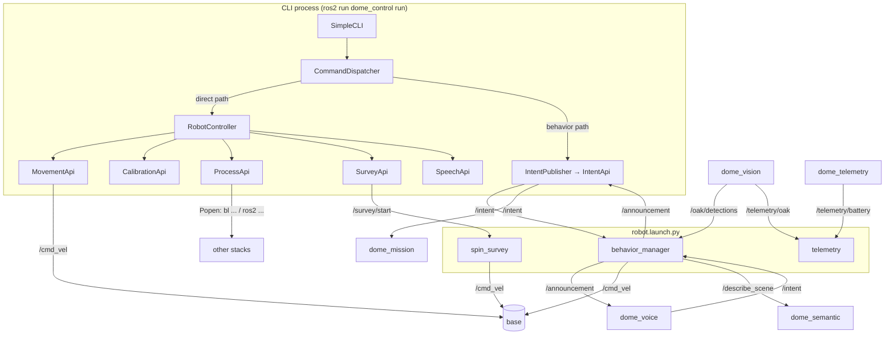

# dome_control — theory of operation

`dome_control` is the DOME robot's control package. It has two faces:

- **A command-line tool** (`ros2 run dome_control run`) that drives the
  robot, manages launches, saves maps, edits config, and sends intents.
- **Three robot-side nodes** started by `robot.launch.py`:
  - `behavior_manager`: acts on motion and perception intents.
  - `telemetry`: one flat health message for Foxglove, plus a CSV history.
  - `spin_survey`: the 360° look-around that feeds the semantic map.

It sits between the voice front end (`dome_voice`), perception
(`dome_vision`, `dome_semantic`), navigation and missions (`dome_nav`,
`dome_mission`), and the hardware drivers (`dome2` gendrv, `dome_telemetry`).

## The big picture

## Two ways a command travels

Every CLI line goes through `CommandDispatcher.dispatch_text`, which
chooses one of two paths (`11-command_dispatcher.md`):

1. **Direct path.** The command maps to a `RobotController` method, which
   calls an API node synchronously in the CLI process. Examples: `move
   forward 1`, `launch start nav`, `config set linear_speed 0.3`,
   `robot subsystems`.
2. **Behavior path.** The command becomes an intent JSON on `/intent`. The
   package that owns that intent name acts on it. For query intents the CLI
   waits up to 5 s for the spoken answer on `/announcement`. Examples:
   `scene describe`, and `mission explore start` (owned by
   `dome_mission`).

**Intent ownership is split by name (F19).** `dome_control` owns `stop`,
`drive_square`, `turn_left`, `turn_right`, `get_status`,
`describe_scene`, `list_objects` and `count_objects`. `dome_mission` owns
the `navigation_*` and `exploration_*` names. Every subscriber sees every
intent, and each one ignores names it doesn't own.

## Reading order

The chapters are numbered in dependency order:

| Chapters | Layer |
|---|---|
| 01–03 | Foundations: config, announcement contract, intent parsing |
| 04–09 | ROS API layer: base, movement, calibration, process, intents |
| 10–12 | CLI: controller, dispatcher, REPL |
| 13–15 | Robot side: behaviors and the behavior manager node |
| 16–17 | Spin survey: pure state machine and its node |
| 18–20 | Telemetry: host stats, CSV history, collector node |
| X01–X15 | Appendices: command tables, small APIs, entry points, launch file |

## Recurring design patterns

- **Pure core, thin ROS shell.** `SpinSurvey`, `IntentParser`,
  `host_stats`, the CSV logger and the behaviors have no `rclpy` imports.
  Their nodes only adapt them, which is why most of the 217 tests need no
  ROS graph.
- **Lazy nodes.** `RobotController` creates each API node on first use.
- **Latest-value caches.** `behavior_manager` caches detections and
  `telemetry` caches battery and OAK messages. Timers or queries read the
  cache.
- **Open-loop motion.** Distances and angles are converted to time at a
  configured speed. Odometry is subscribed to but never used (I03).
- **One `except Exception`** as the CLI's error boundary, in
  `CommandDispatcher.execute`.

## Findings from this rebuild, ranked

Each item points to the chapter with the detail. "Confirmed" means it was
reproduced by running code during the rebuild, not just read.

### Safety

1. **`stop` can't interrupt motion in `behavior_manager`.** Motion blocks
   the node's only executor thread, so a `stop` sent during a
   `drive_square` (~26 s) runs only after the square ends (13, 15).
2. **Nothing stops a spin survey.** `spin_survey` re-publishes `/cmd_vel`
   at 5 Hz, there is no cancel service, and `stop` publishes one zero
   `Twist` (17, X06).
3. **Continuous survey with `pass_count ≥ 2` never ends** (confirmed, 16).
   It isn't hit by today's config (step mode), but the fix is one config
   edit away from being needed.
4. **Stale battery telemetry looks live.** If `dome_telemetry` dies, the
   last voltage is re-published forever (20).

### Correctness

5. **`launch stop` signals `/bin/sh`, not the launch**, can hang forever,
   and fights the capture thread for the pipe and log file (I01, I02,
   still open; 07).
6. **`system kill`'s SIGKILL fallback triggers on the wrong condition**
   (07).
7. **`script circle_stress <d>` ignores the diameter.** The radius is
   always `linear_speed / angular_speed` (06).
8. **`"1"`/`"0"` become booleans** before type conversion (confirmed; the
   `config.set` chore; 11).
9. **`convert_number("1e5")` crashes** (confirmed; I06; 01).
10. **`scene count <type>` drops its argument**, and `count_objects` is
    unimplemented anyway (11, 14).
11. **Query replies aren't correlated.** Any announcement within 5 s,
    including `robot speak`, becomes "the reply" (08).
12. **CLI help files never load from the installed package**
    (confirmed; 12).
13. **Refused or failed actions report success.** That covers
    out-of-limit moves (05, 10) and `describe_scene` failures, which are
    logged but never announced (14).

### Build and packaging

14. **`scripts/speech_output` and `scripts/voice_input` are installed by
    `CMakeLists.txt` but import modules that no longer exist.** Running
    them crashes. Delete both, along with their `install(PROGRAMS …)`
    lines.
15. **`setup.py` is dead.** The package builds with `ament_cmake`, and
    `setup.py`'s entry points have already drifted (no `telemetry_node`).
    Delete it, or move to `ament_python`, to keep one source of truth.
16. **The installed build predates the source.** `install/` differs from
    `src/` for most modules (it was built before the 2026-11-19 ruff
    pass). Rebuild before any hardware test.
17. **There is a dead `spin_survey:` block in `control-config.yaml`** that
    contradicts the `spin_survey.yaml` actually loaded (X15).

### Documentation drift

18. **`current.md` and `notes.md` claim an "Oak Camera not connected"
    announcement** that the code no longer makes (14).
19. **`Telemetry.msg` comments describe the pre-F20 UPS design** (20).
20. **Launch command help advertises `--flag` syntax** the dispatcher
    doesn't support (X04).

### Structure

21. **Three files are over the size guideline:** `ProcessApi` (675 lines),
    `RobotController` (430) and `SimpleCLI` (340). The natural splits are
    in chapters 07 and 10.
22. **Intents are published through two paths** (`RobotController.intent`
    and the dispatcher's `IntentPublisher`), so the CLI runs two intent
    nodes (09).
23. **The `ros2_api` layer imports `CommandResponse` from the commands
    layer**, inverting the dependency (07).
24. **There is no shared intent-name registry.** Names are kept in five
    places: the CLI tables, `REPLY_INTENTS`, `MOTION_INTENTS`,
    `PERCEPTION_INTENTS`, and the voice side (I08).
25. **Nodes are never destroyed in the CLI** (I05; X14).

### Style-guide gaps not caught by ruff

- Leading-underscore helpers: `_validate_config`, `_format_cell`,
  `_publish_twist`, `_client` and others.
- Missing shebangs in `telemetry/*.py`; `EXE001` is ignored.
- Silent `except OSError: pass` in `csv_logger.prune`.
- Older file headers without the stamped `Version`/`Created`/`Updated`
  lines. The pre-commit hook fills these in as files are touched.
