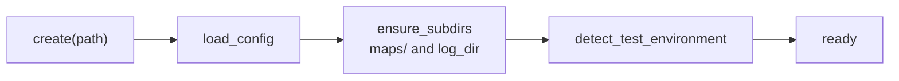

# ConfigManager — one YAML file as the package's memory

`ConfigManager` (`dome_control/commands/config_manager.py`) wraps a single
YAML file, `~/.dome/config/control.yaml`, and makes it the shared,
persistent state of the CLI and the behavior manager. Speeds, velocity
limits, the map name, the log directory and the launch templates all live
there.

It is the first module to read because almost every other class receives a
`ConfigManager` in its constructor.

## A dict that writes itself back

The design is deliberately simple: the YAML file is loaded into a plain
`dict`, and every `set_variable` call writes the whole dict back to disk.

```python
def load_config(self):
    with self.config_file.open() as f:
        self.variables = yaml.safe_load(f) or {}

def save_config(self):
    with self.config_file.open("w") as f:
        yaml.dump(self.variables, f, default_flow_style=False, sort_keys=False)
```

- **No schema.** Any key can be stored. Consumers (for example
  `MovementApi`) check for the keys they need.
- **Write-through.** There is no "save" command; `config set` is durable
  immediately.
- **`sort_keys=False`** keeps the user's hand-written order in the file.
  Comments are still lost on the first save, because PyYAML does not
  round-trip them.

## The factory does the side effects

The constructor only records paths. `create()` is the factory that actually
touches the filesystem and the environment:

```python
@classmethod
def create(cls, config_file: str) -> "ConfigManager":
    manager = cls(config_file)
    manager.load_config()
    manager.ensure_subdirs()
    manager.detect_test_environment()
    return manager
```

This *two-phase construction* lets tests build a bare `ConfigManager` and
poke `variables` directly, without a file on disk.



## Typing values that arrive as strings

The CLI hands values over as strings, so `set_variable` guesses their type:

```python
def set_variable(self, name: str, value: object):
    if not isinstance(value, str):
        self.variables[name] = value
    elif value.lower() in ["true", "false"]:
        self.variables[name] = value.lower() == "true"
    elif self.is_number(value):
        self.variables[name] = self.convert_number(value)
    else:
        self.variables[name] = value
    self.save_config()
```

The guess is two-step: `is_number` asks "would `float()` accept it?", and
`convert_number` then picks `int` or `float` by looking for a `.`. Those two
tests disagree for scientific notation, so `"1e5"` passes `is_number` and
then crashes in `int("1e5")`. This is issue I06, and it is still present.

## Paths relative to the config directory

`resolve_path` anchors relative paths at the config file's directory, so
`log_dir: logs` means `~/.dome/config/logs`. Maps always live in
`~/.dome/config/maps`.

## Dry-run by sniffing the interpreter

```python
def detect_test_environment(self):
    if "pytest" in sys.modules or "unittest" in sys.modules:
        self.variables["dry_run"] = True
```

`dry_run` stops `MovementApi` from publishing `/cmd_vel`. Turning it on
whenever `unittest` has been imported is a heuristic: many libraries import
`unittest` indirectly, and if one of them ever does so on the robot, motion
commands silently become no-ops. This is issue I07.

## Observations

1. **`convert_number("1e5")` crashes** (I06, confirmed). Use one
   `try: int(v) except ValueError: float(v)` instead of two disagreeing
   tests.
2. **Dry-run detection is a guess** (I07). Make `dry_run` an explicit
   constructor argument or config key, and let the test `conftest.py` set
   it.
3. **There are two type-guessing functions.** This one and
   `command_dispatcher.parse_value` both coerce strings, and they disagree:
   `parse_value` maps `"1"`/`"0"` to booleans. That disagreement is the open
   `config.set` chore. Keep one and delete the other.
4. **`save_config` drops comments** from the hand-edited YAML. If comments
   matter, use `ruamel.yaml` or keep a separate machine-written file.
5. **There is no validation boundary.** A typo such as `linear_sped` is
   stored happily and only noticed when a consumer finds the real key
   missing. A small declared schema (key, type, range) would catch this at
   `config set` time.
6. **The header lacks the stamped `Version`/`Created`/`Updated` lines.** The
   pre-commit hook adds them on the next commit that touches the file.
