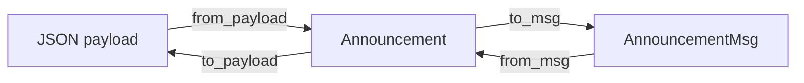

# Announcement contract — one shape for everything the robot says

`announcement_contract.py` defines the shape of messages on `/announcement`,
the topic that `dome_voice` speaks aloud and that the CLI listens on for
query replies. It gives three views of the same thing:

- **`AnnouncementMsg`**: the generated ROS message
  `dome_control/msg/Announcement` (text, priority, stamp, source,
  dedup_key).
- **`Announcement`**: a frozen dataclass, the pure-Python value object.
- **A JSON payload**: the same fields serialized as a string, kept for
  older `std_msgs/String` consumers.

## Priorities

Six priority levels, from safety down to chit-chat, are duplicated as
module constants and as constants in the `.msg` file:

```python
PRIORITY_SAFETY = 0
PRIORITY_STATUS = 1
PRIORITY_QUERY_REPLY = 2
PRIORITY_ACTION_ACK = 3
PRIORITY_DISCOVERY = 4
PRIORITY_CHITCHAT = 5
```

Lower numbers are more urgent. The speech side uses them to decide what may
pre-empt what (deferred `dome_voice` features F08/F09).

## Importable without ROS

The module guards both of its ROS imports and defines stand-in classes when
they fail:

```python
try:
    from dome_control.msg import Announcement as AnnouncementMsg
except ImportError:

    class AnnouncementMsg:
        PRIORITY_SAFETY = PRIORITY_SAFETY
        ...
        def __init__(self):
            self.text = ""
            ...
```

The intent is that pure-logic tests can build messages without a sourced
workspace. The cost is that **a broken build looks like a working one**: if
the generated message is missing, the fake class is used silently and
publishing it on a real ROS publisher fails much later, far from the cause.

## Conversion in both directions



`from_msg` accepts either kind of message: anything with a `.data`
attribute is treated as a `std_msgs/String` carrying JSON.

`from_payload` is deliberately forgiving. Non-JSON text becomes the
announcement text, non-dict JSON is stringified, and a bad priority becomes
`PRIORITY_CHITCHAT`:

```python
if not isinstance(priority, int):
    try:
        priority = int(priority)
    except (TypeError, ValueError):
        priority = PRIORITY_CHITCHAT
```

## The two helpers everyone uses

`make_announcement_msg` and `make_announcement_payload` are the entry
points used by the behaviors. Both default to `PRIORITY_QUERY_REPLY` and
`source="behavior_manager"`, which matches their main caller.

## Observations

1. **The import fallbacks hide build failures.** Since F20 every consumer
   runs in a sourced workspace (the test suite itself needs
   `dome_semantic`), so the fake `Time` and `AnnouncementMsg` classes could
   go. Without them a missing message type fails loudly at import.
2. **`from_payload` repairs bad input** instead of reporting it, against the
   style guide's "report, don't guess" rule. A bad priority quietly becomes
   chit-chat. Raising `ValueError` and letting the caller log it would be
   more honest.
3. **Is the JSON payload path still used?** `/announcement` now carries the
   typed message everywhere in this package. If `dome_voice` no longer
   accepts `String`, `to_payload`/`from_payload` and
   `make_announcement_payload` are dead code.
4. **Priorities are defined twice**, here and in `Announcement.msg`. When
   the message import succeeds, the module constants could simply alias
   `AnnouncementMsg.PRIORITY_*`.
