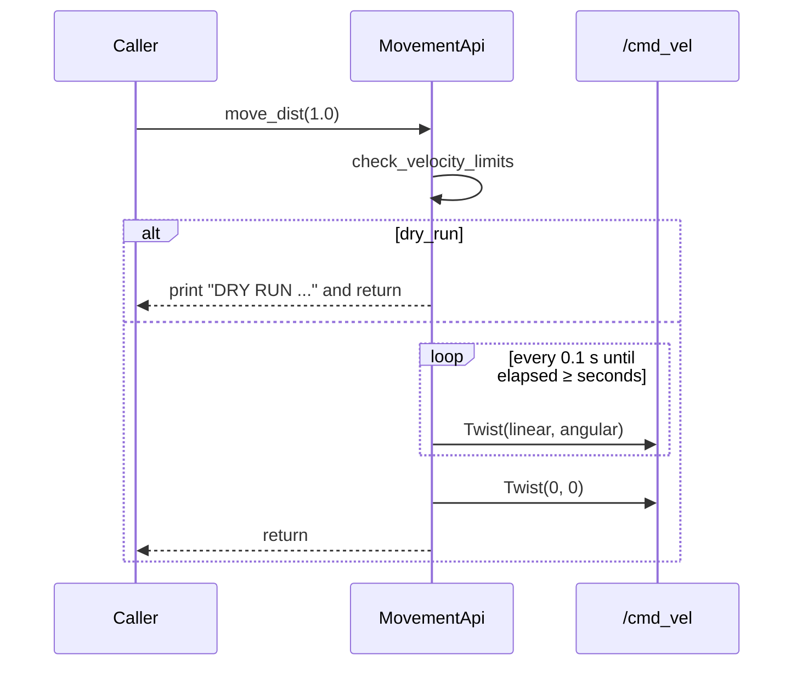

# MovementApi — open-loop motion by timing

`MovementApi` (`ros2_api/movement_api.py`) is how the CLI and the behavior
manager drive the robot. It publishes `geometry_msgs/Twist` on `/cmd_vel`
and implements "move 1 m" or "turn 90°" by **dead reckoning**: drive at a
known speed for `distance / speed` seconds, then publish zero.

## Speeds come from config, every time

All speeds and limits are properties that read the live config:

```python
@property
def linear(self) -> float:
    return self.config.get_variable("linear_speed")
```

So `config set linear_speed 0.3` takes effect on the next move, with no
restart. The constructor checks that the six required keys exist and
raises a `ValueError` naming any that are missing.

## Distance and angle become time

```python
def move_dist(self, distance: float):
    seconds = abs(distance) / self.linear
    actual_speed = self.linear if distance >= 0 else -self.linear
    self.cmd_vel_helper(actual_speed, 0.0, seconds)

def turn_amount(self, angle: float):
    if self.angular == 0:
        self.log_warn("Angular speed is zero, cannot turn.")
        return
    seconds = abs(angle) / self.angular
    ...
```

The model is idealised: it assumes instant acceleration and no wheel slip.
Error grows with distance, and there is no correction, because odometry is
received but never used (below).

`turn_amount` guards against a zero angular speed, but `move_dist` has no
matching guard, so `linear_speed: 0` raises `ZeroDivisionError`.

## The publish loop blocks



```python
start_time = time.time()
while rclpy.ok() and (time.time() - start_time) < seconds:
    self.cmd_vel_pub.publish(twist)
    time.sleep(sleep_duration)
```

The caller's thread is blocked for the whole move, which is fine for the
REPL. The `blocking_ok` class flag exists so a lifecycle-node subclass
could forbid this, but nothing sets it to `False` today.

There are two real consequences:

- **Inside `behavior_manager`**, a `drive_square` intent blocks the node's
  only executor thread for the whole square. A `stop` intent sent
  meanwhile is not processed until the square finishes (see
  `15-behavior_manager_node.md`).
- **`time.time()` is wall-clock time.** An NTP step mid-move changes the
  move's duration. `time.monotonic()` is the right clock for this.

## Limits refuse silently

```python
if not self.check_velocity_limits(linear, angular):
    return
```

An out-of-range speed logs a warning and returns. The caller can't tell, so
`RobotController.move_forward` still reports success.

## Odometry that is never read

The constructor subscribes to `/odom` and stores `current_pose`, but the
CLI never spins this node, so the callback never runs. Nothing reads
`current_pose` either. This is issue I03: movement is open-loop only.

## Observations

1. **Stop can't interrupt motion** in the behavior manager, because the
   move blocks the executor. Move execution to a timer-driven state machine
   (like `SpinSurvey`) or a separate thread, so `stop` cancels it. This is
   the most important item in this module.
2. **Refused moves report success.** Raise on limit violation, or return a
   status that `RobotController` turns into `CommandResponse(False, …)`.
3. **Use `time.monotonic()`** for move timing.
4. **Guard `linear == 0`** the same way `angular == 0` is guarded, or
   better, reject zero speeds once when the config is validated.
5. **`move_time` and `turn_time` ignore sign.** A negative duration just
   returns immediately. Validate durations as positive.
6. **Either close the loop or delete the odometry subscription** (I03). A
   subscription that never fires suggests closed-loop control that doesn't
   exist.
