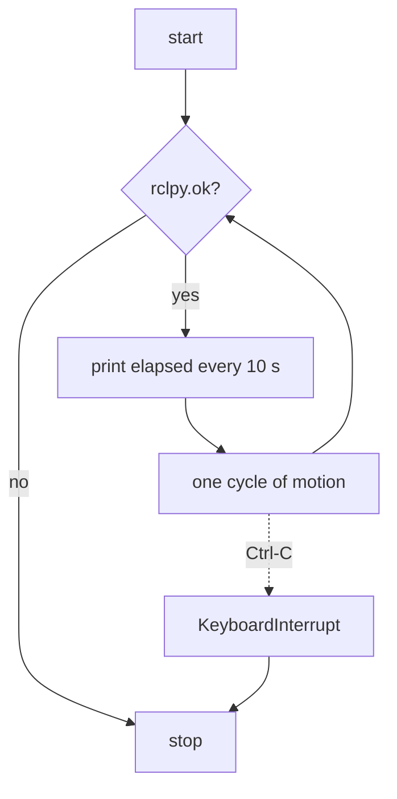

# CalibrationApi — scripted motion patterns

`CalibrationApi` (`ros2_api/calibration_api.py`) runs fixed movement
patterns on top of `MovementApi`, for checking speed calibration and
soaking the drive train. It backs the `script square`,
`script rotate_stress` and `script circle_stress` commands, and the
`drive_square` intent.

## Square: four moves, four turns

```python
def run_square_pattern(self, side_length: float):
    for i in range(4):
        self.movement.move_dist(side_length)
        self.movement.turn_amount(math.pi / 2)
```

Because motion is open-loop, the square is also a calibration test. If the
robot doesn't return to its start point, either `linear_speed` or
`angular_speed` disagrees with reality. The size of the gap after one
square is a quick measure of drift.

## Stress loops run until Ctrl-C

Both stress tests loop on `rclpy.ok()` and stop on `KeyboardInterrupt`:



The rotation test does ten full rotations per cycle at
`stress_test_rotation_speed`. It falls back to 0.2 rad/s if that key is
missing, which hides a missing config entry.

## The circle ignores its diameter

```python
radius = diameter / 2.0
linear_speed = self.config.get_variable("linear_speed")
angular_speed = self.config.get_variable("angular_speed")
...
circumference = 2 * math.pi * radius
circle_time = circumference / linear_speed
self.movement.cmd_vel_helper(linear_speed, angular_speed, circle_time)
```

For a differential-drive robot, the radius of the arc driven is fixed by
the speed ratio: **r = v / ω**. Here both speeds come straight from config,
so the robot always drives a circle of radius `linear_speed /
angular_speed`, whatever diameter was asked for. The diameter only changes
how long each "circle" lasts.

With today's config (0.2 m/s, 1.0 rad/s) every circle has a 0.2 m radius.
`script circle_stress 2` drives that small circle for about 31 s per cycle,
roughly five times round per cycle instead of once round a 2 m circle.

The fix is one line: `angular_speed = linear_speed / radius`, checked
against `angular_max`.

## Observations

1. **`run_circle_stress` doesn't drive the requested circle.** Compute
   ω = v / r. This is a real bug, found during this rebuild.
2. **Output is printed twice.** `_print_elapsed_time` calls `print` and
   then `log_info`, which also prints. The `KeyboardInterrupt` handlers
   also print a second "stopped" line.
3. **`stop()` is called twice** on Ctrl-C, once in the `except` branch and
   once after it.
4. **There are dead variables.** `cycle` is incremented in both loops but
   never read.
5. **The fallback default (0.2 rad/s)** should be a required config key
   checked at startup, like `MovementApi`'s speeds.
6. **Ctrl-C is the only way to stop.** That works at the REPL. Run through
   the behavior manager, there is no Ctrl-C, so a stress test there could
   only be ended by killing the node. Keep these scripts CLI-only, or give
   them a cancel path.
