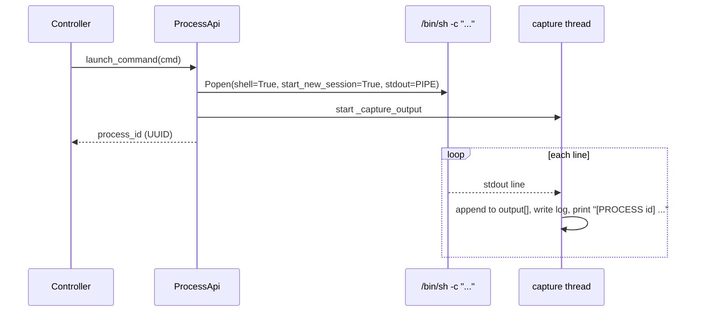

# ProcessApi — launching, watching and killing other programs

`ProcessApi` (`ros2_api/process_api.py`, 675 lines) is the largest module in
the package. It does four loosely related jobs:

1. **Templated launches**: `launch start nav` turns a config template into a
   shell command, starts it, and tracks it by a UUID.
2. **Synchronous commands**: `map save` runs `map_saver_cli` and waits.
3. **System inspection**: `system ps`, `system launches`, `system kill`, and
   `robot subsystems` scan `ps` output.
4. **One ROS read**: `/mission/state` for the `robot subsystems` mission
   row.

Only job 4 needs the class to be a ROS node.

## Launch templates

Templates live under `launch_templates:` in the control config:

```yaml
launch_templates:
  nav:
    command: "bl dome_nav nav.launch.py"
    description: "Navigation stack"
    default_params: {}
```

`launch_by_type` merges the template's `default_params` with the
caller's keyword arguments, then formats them to suit the command:

| Command starts with | Params rendered as |
|---|---|
| `bl` (better_launch) | `--key value` |
| contains `ros2 run` | `--ros-args -p key:=value` |
| anything else | `key:=value` |

A `map` parameter that isn't an absolute path is resolved against
`~/.dome/config/maps/`. If that file doesn't exist, a warning is logged and
the bare name is passed through as-is, which is a guess the launched
program then has to cope with.

## Asynchronous launch: one pipe, one reader thread



`start_new_session=True` puts the child in its own process group, so it
survives the CLI exiting and isn't killed by a terminal Ctrl-C.

## Stopping is where the bugs are

```python
proc_info.process.send_signal(signal.SIGINT)
stdout, _ = proc_info.process.communicate()
proc_info.is_running = False
if proc_info.log_file:
    with open(proc_info.log_file, "w") as f:
        f.write(stdout)
```

There are four problems in these lines:

- **The signal goes to the shell, not the launch.** With `shell=True`,
  `proc.pid` is `/bin/sh`. `send_signal` signals only that pid, while the
  real `ros2 launch` or `bl` process is a child. Because the child leads
  its own session, `os.killpg(proc.pid, SIGINT)` is what reaches the whole
  launch.
- **`communicate()` has no timeout.** If the process ignores SIGINT,
  `launch stop` hangs the CLI forever (issue I02).
- **There are two readers on one pipe.** The capture thread is still
  reading `stdout` when `communicate()` starts reading it too. Each line
  goes to whichever reader wins, so output is split between them (issue
  I01).
- **The log is truncated.** `open(..., "w")` overwrites the log file the
  capture thread has been appending to, keeping only the fragment that
  `communicate()` happened to get (I01).

The fix for all four is to signal the process group, `wait(timeout=…)`,
escalate to SIGTERM/SIGKILL, and let the capture thread alone own the pipe
and the log file.

## `system kill`: the fallback triggers on the wrong condition

`kill_ros_process` checks whether the pid leads its process group, then
runs `kill -TERM`:

```python
try:
    subprocess.run(["kill", "-TERM", target], check=True, timeout=2)
    return CommandResponse(True, f"Sent SIGTERM to {label}...")
except subprocess.CalledProcessError:
    subprocess.run(["kill", "-KILL", target], check=True, timeout=2)
```

`kill` exits non-zero only when it *cannot send* the signal (no such
process, or permission denied). Retrying with SIGKILL in that case fails
the same way. The case SIGKILL is actually for, a process that received
TERM and ignored it, is never detected. The user is told to "run 'system
ps' to verify".

## Subsystem status from one `ps aux`

```python
SUBSYSTEM_KEYWORDS = {
    "gendrv": ["micro_ros_agent"],
    "nav": ["slam_manager_node", "explorer_manager_node", "slam_toolbox", ...],
    "control": ["behavior_manager"],
    ...
}
```

`get_subsystem_status` takes one `ps aux` snapshot and marks a subsystem as
running if any line contains one of its keywords, matched as a substring of
the whole command line. That makes it cheap and dependency-free, but
approximate. A `tail -f behavior_manager.log` would count as "control
running".

On a `ps` timeout or failure, it returns every subsystem as **not
running**. That is a guess presented as a fact: the honest answer there is
"unknown".

## Reading `/mission/state`

```python
qos = QoSProfile(depth=1, durability=QoSDurabilityPolicy.TRANSIENT_LOCAL)
subscription = self.create_subscription(String, "/mission/state", on_state, qos)
deadline = time.monotonic() + timeout_s
while time.monotonic() < deadline and received["value"] is None:
    rclpy.spin_once(self, timeout_sec=0.1)
self.destroy_subscription(subscription)
```

This is the right pattern for a one-shot read of a *latched* topic:
transient-local QoS means a late subscriber still receives the last value,
so there's no race with the publisher's startup.

## Observations

1. **Fix `kill_process`** (I01 and I02, still open): signal the process
   group with `os.killpg`, wait with a timeout, escalate, and let the
   capture thread be the only reader and writer. This is the main
   reliability bug in the CLI.
2. **Fix `kill_ros_process`'s escalation.** Send TERM, poll for exit for a
   couple of seconds, then send KILL. Don't make KILL depend on `kill`'s
   exit status.
3. **Split the module.** It is more than twice the ~300-line guideline.
   Natural pieces are `launcher.py` (templates, Popen, capture),
   `ps_scan.py` (pure parsing of `ps` output, easy to test) and a small
   `mission_state.py` ROS reader. Only the last needs to be a node.
4. **The ROS layer depends on the commands layer.** `ros2_api` imports
   `CommandResponse` from `commands.robot_controller`, with function-level
   imports to avoid the cycle. Return plain data, and let `RobotController`
   build responses.
5. **Report "unknown", not "not running",** when `ps` fails. Also consider
   matching subsystem keywords against the executable name, not the whole
   command line.
6. **There is leftover structure to delete.** `get_launch_status(type)`
   returns a hard-coded `"unknown"`. `kill_by_type` ignores its
   `launch_type` argument. `CommandConfig` is declared above the imports
   (E402). `ros2 run` params are split on whitespace, which breaks any
   value with a space in it.
