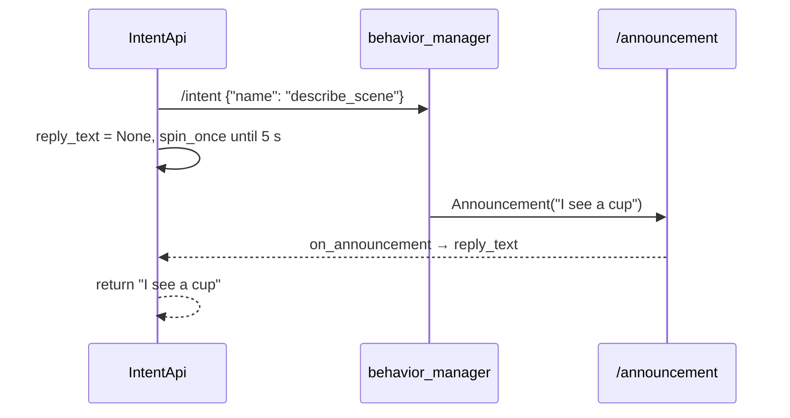

# IntentApi — publish an intent, maybe wait for the answer

`IntentApi` (`ros2_api/intent_api.py`) is the CLI's ROS side of the
behavior path. It publishes intent JSON on `/intent`, and for query intents
it blocks for up to 5 seconds waiting for the spoken reply on
`/announcement`.

## Fire-and-forget vs query

```python
REPLY_INTENTS = {"describe_scene", "list_objects", "get_status", "get_help"}
REPLY_TIMEOUT_S = 5.0

def publish(self, name: str, source: str, slots: dict) -> str | None:
    msg = String()
    msg.data = json.dumps({"name": name, "source": source, "slots": slots})
    self.intent_pub.publish(msg)
    if name not in REPLY_INTENTS:
        return None
    self.reply_text = None
    deadline = time.monotonic() + REPLY_TIMEOUT_S
    while time.monotonic() < deadline and self.reply_text is None:
        rclpy.spin_once(self, timeout_sec=0.1)
    return self.reply_text
```

The node is spun only during that wait, with `spin_once` in a deadline
loop. That is a reasonable way to get synchronous request/reply semantics
out of two topics without a service.



## The reply is not correlated

`on_announcement` takes **any** announcement as the answer:

```python
def on_announcement(self, msg) -> None:
    self.reply_text = msg.text
```

Anything else that speaks during those 5 seconds becomes "the reply": a
voice-side status message, a mission announcement, or `robot speak` from a
second CLI. The `Announcement` message already has `source` and
`dedup_key` fields, so a correlation id is within reach. Send a request id
in the intent's slots, echo it in `dedup_key`, and accept only a match.

## Timeouts look like success

If no reply arrives, `publish` returns `None`. The dispatcher then prints
`✓ Intent published: describe_scene`. A camera that is down, or a
`describe_scene` that failed (the behavior manager logs the failure but
announces nothing), is indistinguishable from a fire-and-forget success.

## Observations

1. **Correlate replies** with a request id, as described above. Without one
   the CLI can print an unrelated sentence as the answer to a query.
2. **Report the timeout.** Return a distinct value (or raise), so the
   dispatcher prints `✗ No reply from behavior_manager within 5 s`.
3. **The reply set is incomplete.** `count_objects` is a perception intent
   but not in `REPLY_INTENTS`. That's harmless today only because
   `count_objects` isn't implemented. The intent names that expect replies
   belong in one shared table with the handlers (issue I08).
4. **There are two publishers for the same thing.** `RobotController` has
   its own `IntentApi` (`publish_intent_*`), and the dispatcher uses
   another via `IntentPublisher`. That is two `intent_api` nodes in one CLI
   process. See `09-intent_publisher.md`.
