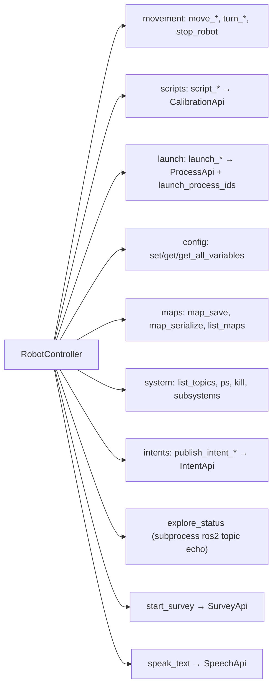

# RobotController — the façade behind every direct command

`RobotController` (`commands/robot_controller.py`) is the object the
dispatcher calls for every command on the *direct path*, that is, every
command that isn't published as an intent. Each public method takes typed
arguments and returns a `CommandResponse`:

```python
@dataclass
class CommandResponse:
    success: bool
    message: str
    data: dict | None = None
```

That uniform return type lets the CLI print any result the same way: a ✓
or ✗, the message, and optionally a formatted `data` table.

The behavior manager also holds a `RobotController`, which `MotionBehavior`
uses to drive.

## Lazy API nodes

```python
@property
def movement(self) -> MovementApi:
    if self.movement_node is None:
        self.movement_node = MovementApi(self.config)
    return self.movement_node
```

Six properties (`movement`, `calibration`, `process`, `intent`, `survey`,
`speech`) each create their node on first use. A `config list` never
touches ROS, and a CLI started on a laptop without `/cmd_vel` still
answers `launch list`.

`intent` and `speech` sleep 0.5 s after creating their node, a crude way to
wait for DDS discovery before the first publish.

## What it does, by group



That is ten responsibilities in one 430-line class, which is why
"split `RobotController`" is on the Next list.

## Launch bookkeeping

The controller, not `ProcessApi`, remembers which launch type maps to which
running process:

```python
self.launch_process_ids = dict.fromkeys(self.config.get_launch_templates().keys())
```

`launch_start` refuses to start a second copy of a running type.
`get_launch_status` checks each recorded process and clears stale ids as it
goes, so `robot status` doubles as garbage collection.

## Every move reports success

```python
def move_forward(self, meters: float) -> CommandResponse:
    self.movement.move_dist(abs(meters))
    return CommandResponse(True, f"Moved forward {abs(meters)} meters")
```

The movement methods return `None` whether the robot moved, was refused by
the velocity limits, or was in dry-run mode. The controller always claims
success.

## Map commands shell out

`map_save` and `map_serialize` build `ros2 run …` / `ros2 service call …`
command lines and run them through `ProcessApi.run_command_sync` with a 15 s
timeout. `run_map_command` reduces failure output to its last non-empty
line. The timeout message hard-codes "15 seconds" instead of using
`config.timeout`.

## Observations

1. **Split it** along the groups above: motion and scripts, launches,
   maps, system and subsystems, intents and mission. Each piece is small
   and the dispatcher only needs `getattr` to find the method. This is
   already a Next step in `current.md`.
2. **Moves should report what happened.** Once `MovementApi` raises or
   returns a status on refused motion, surface it here as
   `CommandResponse(False, …)`.
3. **Delete `publish_intent_explore`.** It publishes `"explore"`, which no
   package handles since F19 split exploration into `exploration_start`
   and `exploration_stop`. Nothing in the command tables references it. The
   other unused `publish_intent_*` methods (`stop`, `describe_scene`,
   `count_objects`) duplicate the dispatcher's behavior path. This is the
   open "duplicate `intent.*`" chore.
4. **Read `/explore/status` with a node, not a subprocess.**
   `explore_status` runs `ros2 topic echo --once` and string-strips YAML
   output. `ProcessApi.get_mission_state` already shows the cleaner
   pattern: subscribe, `spin_once` until a deadline, destroy.
5. **`get_robot_status` is incomplete.** It lists only three of the six
   API nodes, and they are "running" only in the sense of "created".
6. **Nodes are never destroyed.** There is no `shutdown()` that calls
   `destroy_node()` on the six APIs, so `ProcessApi.destroy_node`'s
   "kill all managed processes" never runs (issue I05). Launched processes
   outlive the CLI by design (`start_new_session`), but that should be a
   stated decision, not an accident.
