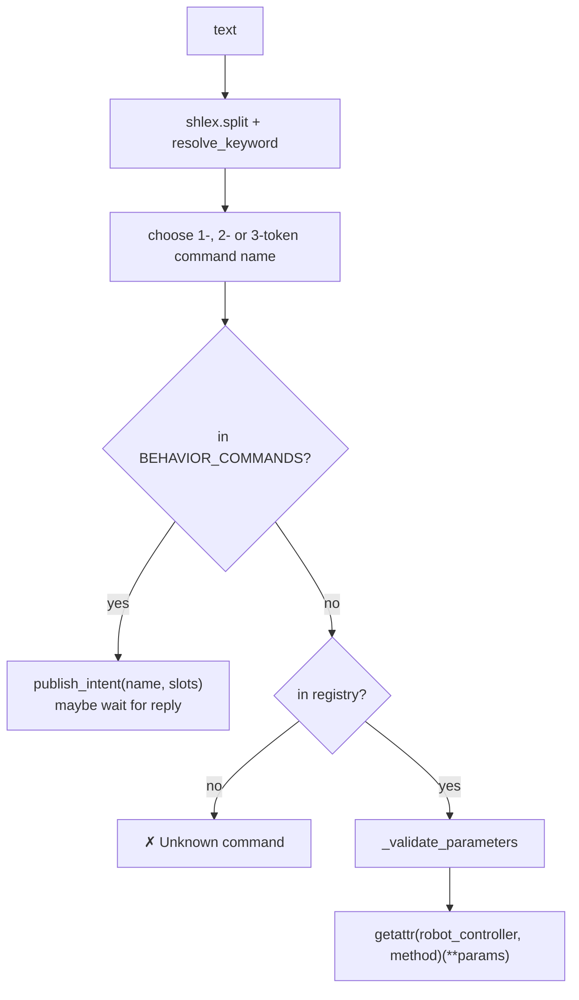

# CommandDispatcher — from typed text to a method call

`CommandDispatcher` (`commands/command_dispatcher.py`) turns a line like
`m fwd 1.5` or `mission explore stop` into a call on `RobotController`, or
into an intent published on `/intent`. It owns three things:

- the **command registry**, assembled from the `*_commands.py` tables
- **keyword resolution**, which expands abbreviations
- **routing** between the behavior path and the direct path

## The registry is a flat dict of dotted names

```python
def _build_command_registry(self) -> dict[str, cd.CommandDef]:
    commands = {}
    commands.update(mov_cmd.build_movement_commands())
    commands.update(ctrl_cmd.build_control_commands())
    ...
    for name, (description, group) in BEHAVIOR_COMMAND_DESCRIPTIONS.items():
        commands[name] = cd.CommandDef("", [], description, group)
    return commands
```

Each key is a dotted path such as `move.forward` or `mission.explore.stop`.
Its `CommandDef` names the controller method and lists typed parameters.
Because `dict.update` silently overwrites, a name defined twice keeps the
last table's definition.

Behavior commands are registered with an **empty method name and no
parameters**. They exist in the registry only so `help` can list them.

## Two routing paths



`BEHAVIOR_COMMANDS` maps CLI names to intent names (`scene.describe` →
`describe_scene`). Everything else goes through validation to a controller
method. The method's return value is wrapped in a `CommandResponse` if it
isn't one already, and any exception becomes `✗ Command execution error:
…`. That `except Exception` is the CLI's single error boundary, which keeps
the REPL alive.

## Choosing how many tokens form the name

Commands can be one, two or three words deep, so the dispatcher has to
decide where the name ends and the arguments begin. The rule is: try the
three-token name first, then the two-token name, then fall back to one
token.

```python
second = resolve_keyword(tokens[1])
candidate2 = f"{command}.{second}"
if len(tokens) >= 3:
    third = resolve_keyword(tokens[2])
    candidate3 = f"{command}.{second}.{third}"
    if candidate3 in self.commands or candidate3 in BEHAVIOR_COMMANDS:
        ...
    else:
        in_registry2 = candidate2 in self.commands or candidate2 in BEHAVIOR_COMMANDS
        if second in FULL_NAMES or second != tokens[1] or in_registry2:
            ...
else:
    in_registry2 = ...  # same block again
```

The two-token decision is written out twice, once in each branch. That is
the kind of duplication the style guide's DRY rule targets, and it makes
the routing rule hard to see.

The two-token condition also accepts any second word that is *some* full
keyword or abbreviation, not just ones that form a real command. So
`move list` builds `move.list` and reports "Unknown command" rather than
treating `list` as an argument.

## Values are typed twice

`parse_value` types each argument as it is tokenised:

```python
def parse_value(value_str: str) -> Any:
    if value_str.lower() in ("true", "yes", "1"):
        return True
    if value_str.lower() in ("false", "no", "0"):
        return False
    ...
```

Then `_convert_parameter_value` converts it again to the declared
parameter type. That causes two confirmed problems:

- `"1"` becomes `True` before the parameter type is known.
  `config set retries 1` then stores a boolean, because `config.set`'s
  value parameter is a `str` and `str(True)` is `"True"`, which
  `ConfigManager` reads back as a bool. That is the open `config.set`
  chore.
- For `bool` parameters, any string other than `true/1/yes/on` silently
  becomes `False`, so a typo such as `--use-sim-time ture` means off.

The fix is to tokenise to strings only, and convert once against the
declared `ParameterDef.param_type`, raising on anything unrecognised.

## Behavior commands lose their arguments

```python
slots = {}
cmd_def = self.get_command_info(command_name)
if cmd_def and args:
    slots = {cmd_def.parameters[i].name: args[i] for i in ...}
```

Behavior commands are registered with no parameters, so `slots` is always
empty. `scene count cup` publishes `count_objects` with `{}`, and the `cup`
is dropped. That is the open "real `CommandDef`s for `scene.*`" chore.

## Observations

1. **Untangle `dispatch_text`.** Write one helper,
   `resolve_command_name(tokens) -> (name, arg_tokens)`, that tries depth
   3, then 2, then 1 *against the registry only*. That removes the
   duplicated branch and the `second != tokens[1]` heuristic.
2. **Convert arguments once.** Delete `parse_value`'s boolean shortcut and
   let `_convert_parameter_value` do typed conversion that raises on bad
   input. This closes the `config.set` 0/1 chore.
3. **Give behavior commands real `CommandDef`s.** Make them a proper
   command table with parameters and an `intent_name` field instead of a
   `method_name`, so slots are filled and validated. This closes the
   `scene.*` chore.
4. **Remove the `intent.*` aliases** (the "duplicate `intent.*`" chore).
   They duplicate `scene.*` and leak an implementation term into the CLI.
5. **Make the publisher required.** Without an injected publisher,
   `publish_intent` creates a new ROS node per call (I05).
6. **Detect name collisions.** Assert when building the registry that no
   two tables define the same name.
