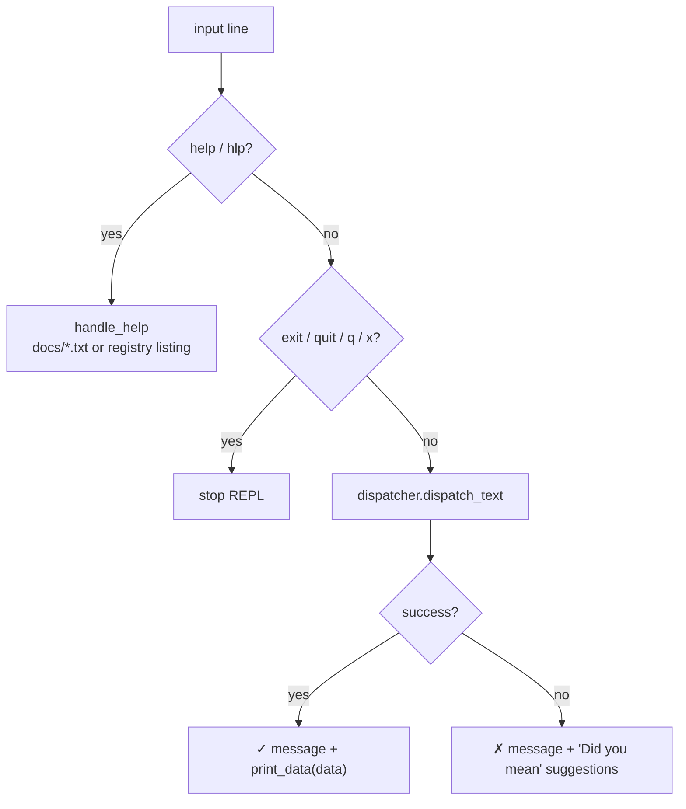

# SimpleCLI — the REPL and one-shot command runner

`SimpleCLI` (`interface/simple_cli.py`) is what `ros2 run dome_control run`
starts. With arguments, it runs one command and exits. Without arguments,
it is a `prompt_toolkit` REPL with persistent history. It owns only
presentation: help screens, ✓/✗ output and table formatting. Everything
else goes to `CommandDispatcher.dispatch_text`.

## Startup wiring

```python
def __init__(self):
    config_path = str(Path.home() / ".dome" / "config" / "control.yaml")
    self.config_manager = cm.ConfigManager.create(config_path)
    self.robot_controller = rc.RobotController(self.config_manager)
    self.intent_publisher = IntentPublisher()
    self.intent_publisher.get_api()  # warm up ROS2 node + DDS discovery
    self.dispatcher = cd.CommandDispatcher(self.robot_controller, self.intent_publisher)
```

The config path is fixed; the `CONTROL_CONFIG` override was removed on
2026-08-04. The intent node is created eagerly, so DDS has already
discovered `behavior_manager` by the time the user types `scene describe`.

## What the CLI handles itself



- **Help** first looks for a hand-written file, `docs/<cmd>.<sub>.txt`,
  then falls back to listing matching registry entries.
- **`print_data`** recognises three response shapes (`variables`, `status`,
  `subsystems`) and renders them with `format_table`. Anything else is
  printed as `key: value` lines.
- **History** goes to two files: `prompt_history.txt` for up-arrow recall,
  and `command_history.txt`, a timestamped audit log.

## Help files never load from the install

```python
def load_help_file(self, filename: str) -> str | None:
    docs_dir = Path(__file__).resolve().parent.parent.parent / "docs"
```

Three levels up from `interface/simple_cli.py` is the repo root, but only
in the source tree. When installed, the file lives in
`install/dome_control/lib/python3.12/site-packages/dome_control/interface/`,
so the path resolves to `…/site-packages/docs`, which doesn't exist.
`CMakeLists.txt` doesn't install `docs/` either. So **every detailed help
file is unreachable** from `ros2 run dome_control run`. Help silently falls
back to the one-line registry listing, and nobody notices.

## Table formatting

`format_table` is a small pure function: column widths are the maximum of
the heading and each cell, `None` prints as `-`, booleans as `yes`/`no`,
and the last column isn't padded, so there is no trailing whitespace. It
is unit-tested in `test_simple_cli_formatting.py`.

## Observations

1. **Install and locate `docs/` properly.** Add `install(DIRECTORY docs
   DESTINATION share/${PROJECT_NAME})` and find it with
   `get_package_share_directory("dome_control")`. Alternatively, drop the
   hand-written help files in favour of registry descriptions, which also
   resolves the stale-README chore's twin `docs/_index.txt`.
2. **One-shot mode loses quoting.** `" ".join(sys.argv[1:])` re-joins the
   arguments, so `run robot speak "hello world"` survives only because
   `robot.speak` joins trailing words. Pass `sys.argv[1:]` to the
   dispatcher as tokens instead.
3. **Suggestions match on text.** `"Unknown command" in result.message`
   ties behavior to an English sentence. A `CommandResponse` error kind
   (`UNKNOWN_COMMAND`) would be sturdier.
4. **`show_common_commands` is hand-maintained** and already lists
   `scene count`, which does nothing useful yet. Generate it from the
   registry, with a "common" flag on `CommandDef`.
5. **There is no clean shutdown.** The REPL exits without destroying the
   controller's nodes (I05). Add a `shutdown()` to `RobotController` and
   call it in a `finally`.
6. **Private helpers break naming rules.** `_format_cell` and
   `_format_table_row` break the "no leading underscore" rule.
