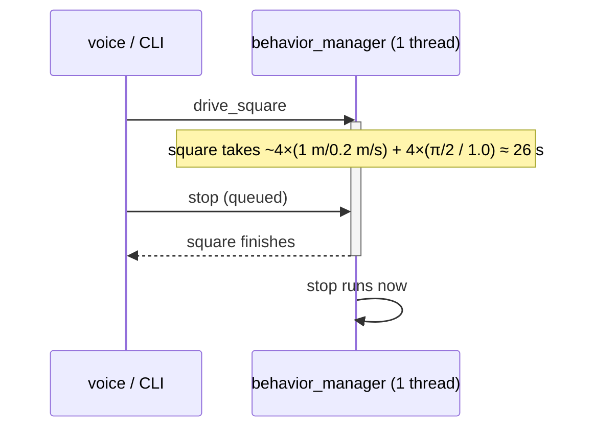

# MotionBehavior — motion intents as controller calls

`MotionBehavior` (`behaviors/motion_behavior.py`) is the behavior manager's
handler for the motion domain:

`stop` · `drive_square` · `turn_right` · `turn_left` · `get_status`

It has no ROS imports. It translates an `Intent` into `RobotController`
calls, and for `get_status` it publishes a spoken reply through the node
it is given.

## The handler protocol

Every behavior has the same two methods, and the node tries them in order:

```python
def handles(self, intent_name: str) -> bool:
    return intent_name in MOTION_INTENTS

def execute(self, intent: Intent, node=None) -> None:
    ...
```

That is a simple *chain of responsibility*: the first handler that claims
the name runs it. Because each name belongs to exactly one handler, the
order doesn't matter.

## The dispatch is an if-chain

```python
if intent.name == "stop":
    self.rc.stop_robot()
elif intent.name == "drive_square":
    meters = float(intent.slots.get("meters", 1.0))
    self.rc.script_square(meters)
elif intent.name == "turn_right":
    self.rc.turn_clockwise(TURN_DEGREES)
elif intent.name == "turn_left":
    self.rc.turn_counterclockwise(TURN_DEGREES)
elif intent.name == "get_status" and node is not None:
    ...
```

Five branches is past the style guide's three-branch smell. A table of name
→ method would also make `MOTION_INTENTS` derivable instead of a second
list kept in sync by hand.

## Everything blocks the node

`script_square` drives four sides and four turns through
`MovementApi.cmd_vel_helper`, which sleeps in a loop. `execute` runs inside
the behavior manager's `/intent` callback, on the node's single executor
thread. So:



**`stop` cannot interrupt a moving robot.** The same holds for a 90° turn,
though at about 1.6 s it matters less. This is the most important behavior
bug in the package. The usual fix is to make motion a timer-driven state
machine on the node, as `SpinSurvey` does, so a `stop` callback can cancel
it between ticks.

## `get_status` speaks two numbers

`get_status` reads the controller's status and announces the configured
linear and angular speeds. Those are config values, not measured motion.
"Status" is a stretch for that.

## Observations

1. **Make motion cancellable.** Move execution off the callback, either to
   a timer-stepped plan or to a worker thread with a cancel flag, and have
   `stop` cancel the current plan before publishing zero velocity. Add a
   test that `stop` during `drive_square` takes effect within one tick.
2. **`stop` doesn't stop the spin survey.** `spin_survey_node` publishes
   `/cmd_vel` on its own 5 Hz timer. A `stop` intent publishes one zero
   `Twist`, which the next survey tick overrides. A real stop needs to
   reach every `/cmd_vel` publisher, for example a `/survey/cancel` service
   that `stop` also calls, or a mux with a stop lock.
3. **Validate slots at the boundary.** `float(intent.slots.get("meters",
   1.0))` raises inside the ROS callback on a bad slot, and the default
   1.0 m is invisible to the caller.
4. **Use a lookup table** for dispatch, from which `MOTION_INTENTS` is
   derived.
5. **`node=None` signals a muddled interface.** `PerceptionBehavior` gets
   its node at construction and ignores the argument, while this class
   gets it per call and ignores `get_status` when it's missing (I09).
   Pass the announcement publisher in at construction for both.
