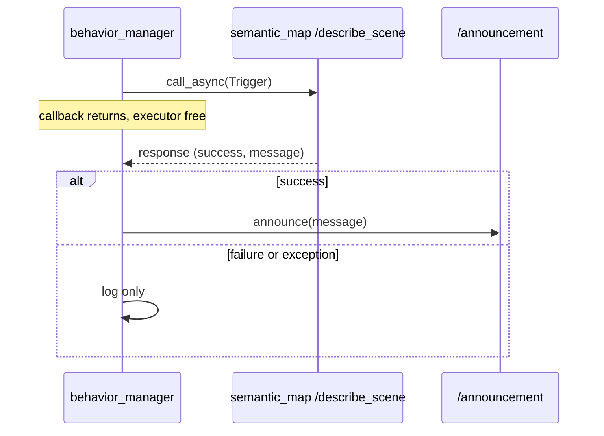

# PerceptionBehavior — answering "what do you see?"

`PerceptionBehavior` (`behaviors/perception_behavior.py`) handles the
perception intents:

- **`describe_scene`**: asks `dome_semantic`'s `SemanticMapNode`, through
  the `/describe_scene` Trigger service, and speaks its answer.
- **`list_objects`**: speaks the labels and scores of the latest
  `/oak/detections` message, which the node caches.
- **`count_objects`**: accepted, then only logs "not yet implemented".

Unlike `MotionBehavior`, it never blocks: the service call is asynchronous.

## Asynchronous service call, with a callback

```python
def call_describe_scene(self) -> None:
    client = self.node.describe_scene_client
    if not client.service_is_ready():
        self.node.get_logger().warn("/describe_scene not ready — attempting call anyway")
    future = self.node.describe_scene_client.call_async(Trigger.Request())
    future.add_done_callback(self.on_describe_scene_done)
```

`call_async` plus `add_done_callback` is the right pattern inside a node's
callback. A blocking `call()` there would deadlock the single-threaded
executor, which has to spin for the response to arrive.



## Failure is silent to the user

When the service isn't ready, the code logs a warning and calls anyway.
When the call fails or returns `success=False`, it only logs. **Nothing is
announced** in either case. The CLI waits the full 5 s and then prints
`✓ Intent published: describe_scene`, and a voice user hears nothing.

`current.md` and `notes.md` describe an "Oak Camera not connected"
announcement when the service isn't ready. **That code isn't here any
more**: the documentation has drifted from the implementation.

There is also a subtler gap. If `semantic_map` is not running at all, the
future may never complete, so no callback ever fires and nothing is even
logged.

## Listing detections

```python
for det in detections.detections:
    if det.results:
        best = max(det.results, key=lambda r: r.hypothesis.score)
        canonical = label_map.get(raw_label, raw_label)
        profile = profiles.get(canonical)
        label = (profile.display_name or canonical) if profile else canonical
```

Each detection keeps its best hypothesis. Its raw class id is mapped
through `dome_semantic`'s class profiles to a canonical name and a
human-friendly display name. The result is a sentence such as
`"I see: cup 0.87, chair 0.62"`.

Two limits apply:

- The cache is whatever arrived last, with **no age check**. If the camera
  stopped an hour ago, the robot still "sees" that hour-old frame.
- Duplicates are not grouped, so three cups read out as three separate
  entries.

## Observations

1. **Announce failures.** Speak a short failure ("I can't see right now")
   on not-ready, exception or `success=False`, and add a timeout so a
   missing server doesn't leave the request dangling. Update the notes to
   match whatever is chosen.
2. **Put an age limit on cached detections.** Keep the receive time in
   `on_detections`, and treat anything older than a couple of seconds as
   "no objects".
3. **Decide on `count_objects`.** Implement it from the same cache (group
   by canonical label), or drop it from `PERCEPTION_INTENTS`, the CLI
   (`scene count`) and the help text. Today it is advertised but inert.
   This overlaps F16's status mismatch.
4. **Group the readout:** "two cups and a chair" reads better than three
   separate entries.
5. **Too much defensive `getattr`.**
   `getattr(self.node, "label_map", {})` hides a wiring error. The node
   always has these attributes, so access them directly or pass them in.
