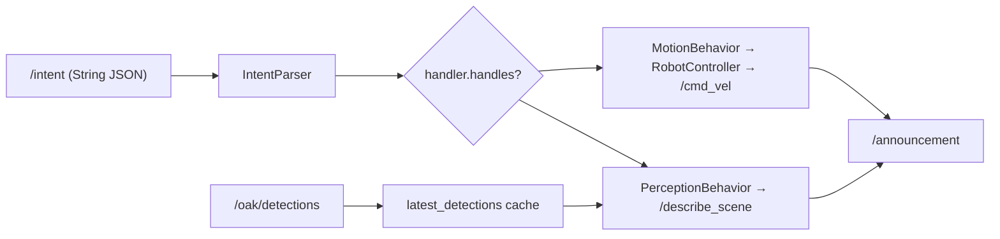

# BehaviorManagerNode — the robot-side intent router

`BehaviorManagerNode` (`nodes/behavior_manager_node.py`) is the
long-running ROS node that receives intents on `/intent` and runs the ones
`dome_control` owns. It is started by `robot.launch.py` and is the
"control" row in `robot subsystems`.

## What it wires together



The constructor builds:

- an `IntentParser`
- a `RobotController` over the same `control.yaml` the CLI uses
- the two behaviors
- the `/intent` and `/oak/detections` subscriptions
- the `/announcement` publisher
- the `/describe_scene` client

It also loads `dome_semantic`'s class profiles, from a path that is a ROS
parameter defaulting to that package's share directory. That makes
`dome_semantic` a hard runtime dependency. It is also why the unit tests
fail to import without a sourced workspace.

## Routing

```python
def on_intent(self, msg: String) -> None:
    try:
        intent = self.parser.parse_intent(msg.data)
    except ValueError as exc:
        self.get_logger().warn(str(exc))
        return
    if intent.name == "get_help":
        ...publish help sentence...
        return
    for handler in self.handlers:
        if handler.handles(intent.name):
            handler.execute(intent, self)
            return
    self.get_logger().warn(f"Unhandled intent: {intent.name}")
```

Mission intents (`exploration_start`, `navigation_go`, …) also arrive here,
because every node subscribed to `/intent` sees every intent. They are
**logged as "Unhandled"** on every use, which is noise. They are handled
correctly by `dome_mission`, so the warning isn't a fault.

`get_help` is handled inline with a hard-coded sentence. It names
"explore", which `dome_control` doesn't own.

## One thread for everything

`main` calls `rclpy.spin(node)` with the default single-threaded executor.
Intent callbacks, detection callbacks and service responses all share that
one thread. Perception is asynchronous and so cooperates, but motion
blocks. During a `drive_square`:

- incoming `stop` intents queue and run only after the square
- `/oak/detections` stop updating
- `describe_scene` replies wait

See `13-motion_behavior.md` for the fix.

## Clean shutdown

```python
try:
    rclpy.spin(node)
except (KeyboardInterrupt, ExternalShutdownException):
    pass  # Ctrl-C or the launcher's SIGTERM: a normal stop
finally:
    node.destroy_node()
    rclpy.try_shutdown()
```

This is the DOME launch-convention shutdown (dome2 F05). The node's
embedded `RobotController` API nodes are not destroyed, but they die with
the process.

## Observations

1. **Fix stop-during-motion** (see `13-motion_behavior.md`). It is the
   highest-value change in the package for safety. As an interim
   mitigation, a `MultiThreadedExecutor` with the motion call in its own
   callback group would at least let `stop` run, although `stop` still
   can't cancel the loop without a shared cancel flag.
2. **Keep a list of known names to ignore.** Silently skip the mission
   intents that `dome_mission` owns, so the warning only fires for names
   nobody owns. Better still is one shared intent registry (I08).
3. **Move `get_help` into a behavior**, or a small `MetaBehavior`, so the
   node is routing only. Generate the sentence from the registered
   handlers.
4. **Embedding a full `RobotController` is heavy.** `MotionBehavior` needs
   only movement and the square script. Giving it a `MovementApi` and
   `CalibrationApi` directly would avoid creating a `ProcessApi` and its
   launch-template parsing inside the robot node.
5. **Mark the hardware dependency in tests.** Make the class-profile load
   injectable, so routing tests don't need `dome_semantic` installed.
