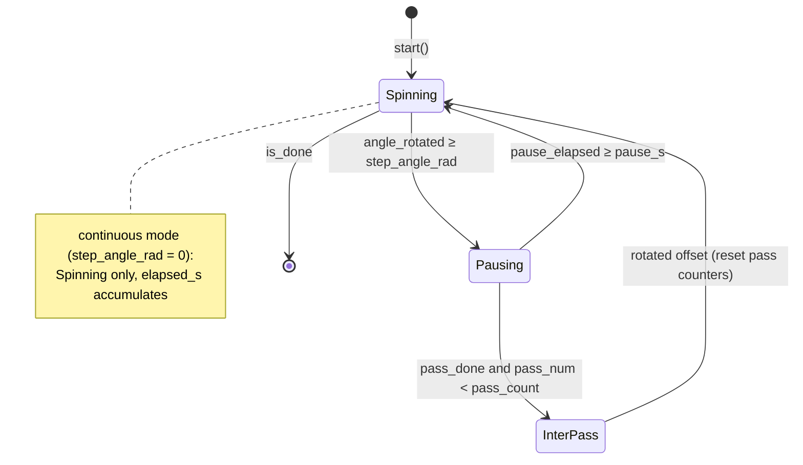

# SpinSurvey — a 360° look-around as a pure state machine

`SpinSurvey` (`spin_survey.py`) decides what angular velocity the robot
should command on each tick of a survey spin, and when the spin is
finished. It has no ROS imports: the node (`17-spin_survey_node.md`) pumps
`tick(dt)` on a timer and publishes the result.

The purpose is perception. Rotating in place lets the OAK camera see the
whole room, so `dome_semantic` can build its map.

## Why step-and-pause

A camera on a spinning robot gets motion-blurred frames. **Step mode**
rotates by `step_angle_rad`, then holds still for `pause_s`, so each pause
yields sharp frames. The robot config uses 0.5 rad steps, about 29°,
comfortably inside the camera's ~55° horizontal field of view, so
consecutive views overlap.

**Multiple passes**, offset by `pass_offset_rad`, put the camera at
in-between headings on the second turn. That is a cheap way to double
angular coverage without smaller steps.

## The state machine



The state lives in a handful of fields (`is_pausing`, `is_inter_pass`,
`pass_num`, `elapsed_s`, `angle_rotated`) rather than an explicit enum.
`tick` routes to `inter_pass_tick` or `step_tick` based on them.

Progress is measured in **commanded time, not measured angle**.
`elapsed_s` counts only spinning time, and a pass is done when
`elapsed_s ≥ total_angle / angular_velocity`. Like `MovementApi`, this is
open-loop: wheel slip shows up as a short survey.

## A confirmed bug: continuous mode with several passes never ends

```python
def tick(self, elapsed_s):
    if self.is_done():
        return (0.0, True)
    if self.is_inter_pass:
        return self.inter_pass_tick(elapsed_s)
    if self.step_angle_rad <= 0.0:
        self.elapsed_s += elapsed_s
        return (0.0, True) if self.is_done() else (self.angular_velocity_rad_s, False)
    return self.step_tick(elapsed_s)

def is_done(self):
    if self.is_inter_pass:
        return False
    if self.pass_num < self.pass_count:
        return False
    ...
```

Only `step_tick` ever advances `pass_num`. In continuous mode
(`step_angle_rad = 0`) with `pass_count ≥ 2`, `pass_num` stays 1, so
`is_done()` is always `False` and **the robot spins forever**. This was
reproduced during this rebuild: `SpinSurvey(0.5, 1.0, step_angle_rad=0,
pass_count=2)` was still spinning after 200 ticks, while the same call with
`pass_count=1` finishes in 11.

The robot config uses step mode, so it isn't hit today. It is one config
edit away, though, and `stop` doesn't halt the survey either (see
`13-motion_behavior.md`).

## Two sets of defaults

`SpinSurveyConfig` (the pydantic model the node uses for parameter
declaration) and `SpinSurvey.__init__` disagree:

| Field | `SpinSurveyConfig` | `SpinSurvey.__init__` |
|---|---|---|
| `step_angle_rad` | 1.047 (step mode) | 0.0 (continuous) |
| `pass_offset_rad` | 0.0 | `None` (meaning auto) |

The node reconciles `pass_offset_rad` with `params["pass_offset_rad"] or
None`. As a result, an explicit `0.0` offset can't be requested: it always
means "auto = step/2".

## Observations

1. **Fix continuous multi-pass.** Either advance `pass_num` when a
   continuous pass's time is reached, or reject `pass_count > 1` with
   `step_angle_rad == 0` at construction. Add the reproduction above as a
   regression test.
2. **Validate the inputs.** `angular_velocity ≤ 0` divides by zero or
   finishes immediately, and a negative total angle is accepted. Raise a
   `ValueError` in `__init__`.
3. **Keep one set of defaults.** Have `SpinSurvey` take a
   `SpinSurveyConfig` instance and drop its own keyword defaults. Then
   pydantic, which is currently used only to enumerate field names, earns
   its place by validating.
4. **Use an explicit state enum.** `SPINNING / PAUSING / INTER_PASS / DONE`
   would replace four interacting booleans and make the state diagram
   above checkable in tests.
5. **Make "auto offset" explicit.** Use `None` or a negative sentinel in
   the YAML, so `0.0` can mean zero.
