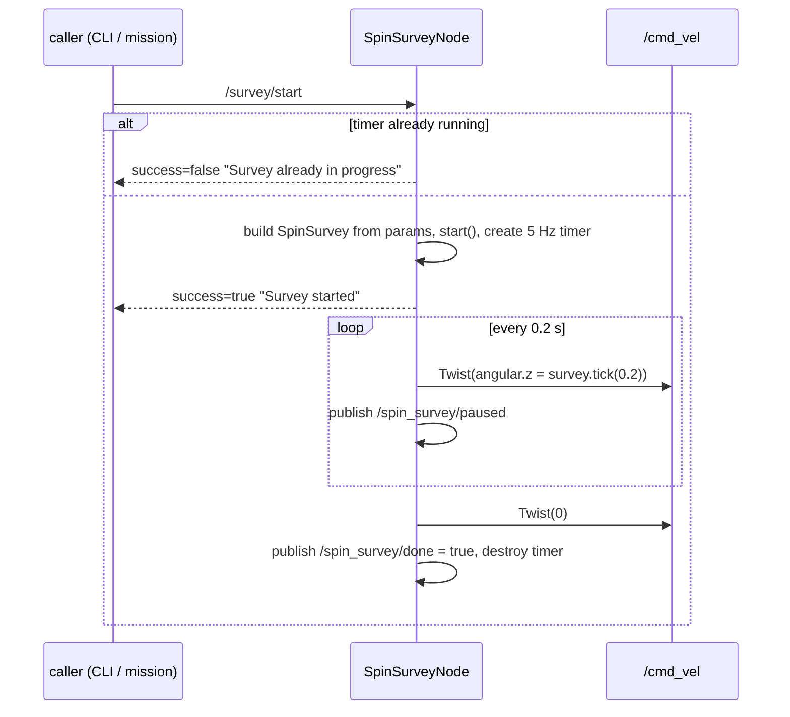

# SpinSurveyNode — the ROS shell around SpinSurvey

`SpinSurveyNode` (`nodes/spin_survey_node.py`) exposes `SpinSurvey` as a
service. It sits idle until `/survey/start` (`std_srvs/Trigger`) is
called. Then it runs a 5 Hz timer that publishes `/cmd_vel` until the
survey reports done.

The node moved here from `dome_vision`, and it is the target of the CLI's
`survey start` command (`SurveyApi`).

## Parameters from the config model

```python
cfg = SpinSurveyConfig()
for name in SpinSurveyConfig.model_fields:
    self.declare_parameter(name, getattr(cfg, name))
```

Every field of the pydantic model becomes a ROS parameter with the model's
default. `robot.launch.py` loads `config/spin_survey.yaml` over them.
Parameters are re-read on every `/survey/start`, so `ros2 param set` takes
effect on the next survey without a restart.

## Start, tick, complete



The service returns as soon as the survey has **started**, not when it
finishes. Callers learn about completion from `/spin_survey/done`. That
keeps the service callback short, which is correct for a single-threaded
node.

`/spin_survey/paused` is published every tick so `dome_vision` can gate
inference to the still frames.

## Ticks assume perfect timing

`tick` passes the nominal `1.0 / TICK_HZ` to the survey, not the measured
time since the last tick. On a loaded Pi, late timer callbacks make the
survey run long, because it counts nominal time, though it stays
internally consistent. Passing the measured `dt` from the node clock would
be more faithful.

## Observations

1. **Add a cancel path.** There is no `/survey/stop`, and a `stop` intent
   from the behavior manager publishes a single zero `Twist` that the next
   tick overrides. The only way to halt a survey is to kill the node. Add a
   cancel service and have `stop` call it. This is a safety item.
2. **Don't fight other `/cmd_vel` publishers.** During a survey,
   `MovementApi` and Nav2 can publish too, and the last writer wins. A
   `twist_mux` (or at least "refuse to start while Nav2 is active") would
   make ownership explicit.
3. **Pass the measured `dt`** to `survey.tick`, using the node clock.
4. **Validate parameters on start.** Invalid parameters (zero velocity,
   continuous multi-pass) should make `/survey/start` return
   `success=false` with a reason, instead of spinning forever (see
   `16-spin_survey.md`).
5. **Private helpers break naming rules.** `_publish_twist` and `_complete`
   break the "no leading underscore" rule.
