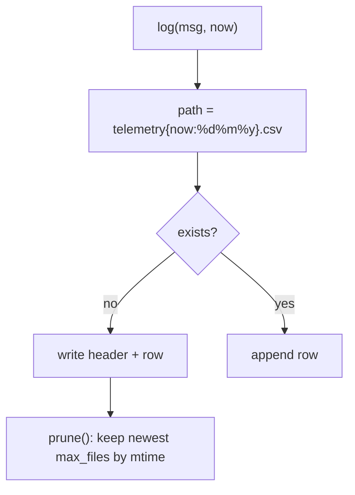

# TelemetryCsvLogger — a daily, size-capped CSV history

`telemetry/csv_logger.py` appends a row of telemetry to
`~/.dome/telemetry/telemetryDDMMYY.csv` every `log_interval_s` (default
10 s). It keeps at most `max_log_files` (default 25) daily files. That
gives the robot a few weeks of health history that survives reboots and
can be opened in any spreadsheet.

## Columns follow the message

```python
FIELDS = ("ups_bus_voltage_v", "ups_current_a", ..., "pi_uptime_s")
HEADER = ("timestamp",) + FIELDS

def row_for(msg, now):
    return [now.isoformat(timespec="seconds")] + [getattr(msg, f) for f in FIELDS]
```

`FIELDS` is a hand-kept copy of `Telemetry.msg`'s field list. A field
added to the message is silently left out of the CSV until someone adds it
here too.

## A new day means a new file, which triggers a prune



Pruning only runs when a file is created, at most once a day, which keeps
the 10 s logging path to a single append.

## Why prune by mtime

`DDMMYY` names don't sort chronologically: `010226` (1 Feb) sorts before
`311225` (31 Dec). So the oldest files are chosen by modification time.
That works, but it is a workaround for the naming. Copying files with
`cp` without `-p` resets their mtimes and scrambles the order.

```python
files.sort(key=os.path.getmtime)  # oldest first
for stale in files[: len(files) - self.max_files]:
    try:
        os.remove(stale)
    except OSError:
        pass
```

## Observations

1. **Name files `telemetryYYYYMMDD.csv`.** ISO order sorts
   chronologically, so pruning can sort by name and the mtime caveat
   disappears. Existing files would need a one-time rename, or keep
   accepting both patterns during the transition, per the style guide's
   persisted-format rule.
2. **Derive `FIELDS` from the message.**
   `Telemetry.get_fields_and_field_types()` lists them, minus `header`, so
   the CSV can't drift from the `.msg`.
3. **`except OSError: pass` breaks the style guide** ("no silent `except X:
   pass`"). At least log the failure: a prune that keeps failing means the
   disk slowly fills.
4. **Timestamps are local and unzoned.** `datetime.now().isoformat()` has
   no UTC offset, so rows logged across a DST change are ambiguous. Use
   `datetime.now().astimezone()`.
