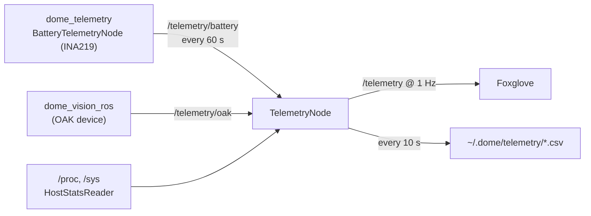

# TelemetryNode — one flat message for the whole robot

`TelemetryNode` (`nodes/telemetry_node.py`) publishes
`dome_control/msg/Telemetry` on `/telemetry` at `publish_rate_hz` (default
1 Hz). The message is a single flat record of UPS, OAK and host metrics, so
Foxglove can plot `/telemetry.<field>` directly without parsing JSON.

## The node owns no hardware



Each device has exactly one owner process. The INA219 belongs to
`dome_telemetry` (F20) and the OAK to the vision stack. Telemetry
subscribes to what they publish. That removes the device-ownership
conflicts an earlier design had, and lets telemetry run whatever else is
running.

## Merge on a timer, not on arrival

```python
def on_ups(self, msg):
    self.latest_ups = msg

def tick(self):
    msg = build_message(self.latest_ups, self.latest_oak, self.host.read(), self.get_clock())
    self.latest_msg = msg
    self.pub.publish(msg)
```

The subscriptions only cache. The timer builds and publishes a snapshot
from whatever is cached. This *latest-value merge* decouples the output
rate from the very different input rates (battery every 60 s, OAK at its
own rate), at the cost of re-publishing values that may be old.

`build_message` is a free function taking the clock as an argument, so it
unit-tests without a node.

## Fail-soft, and stale forever

A source that hasn't published yet leaves its fields at 0. A source that
**stops** publishing is worse: its last message stays cached and is
re-published every second indefinitely. If `dome_telemetry` crashes, the
battery voltage on Foxglove freezes at its last value and looks healthy.
On a robot whose battery can run flat, that is the case that matters most.

## The message definition has drifted

`msg/Telemetry.msg` still describes the UPS block as "INA219, read over
I2C" and `ups_percent` as a "3S LiPo linear, ±20%" estimate. Since F20,
UPS data arrives from `dome_telemetry`, whose `SocEstimator` uses a
session-peak voltage model rather than a linear one. The comments belong
to the old design.

## Observations

1. **Mark stale sources.** Keep the receive time per source and, past
   about 3× its publish period, publish `NaN` (or add per-source `*_age_s`
   fields). Battery staleness is the critical case.
2. **Use `NaN` for "no data yet"**, instead of 0, for the same reason as in
   `host_stats` (`18-host_stats.md`).
3. **Update `Telemetry.msg` comments** for F20: UPS comes from
   `/telemetry/battery` and `ups_percent` comes from `SocEstimator`.
4. **There are lazy imports inside `__init__`.**
   `from dome_telemetry_msgs.msg import …` belongs at the top with the
   other imports. Nothing here needs to be importable without it.
5. **The entry points disagree.** `setup.py` lists no `telemetry_node`
   entry point, but the package builds with `ament_cmake` and installs
   `scripts/telemetry_node`, so it works. `setup.py` is unused and
   misleading; see `00-overview.md`.
